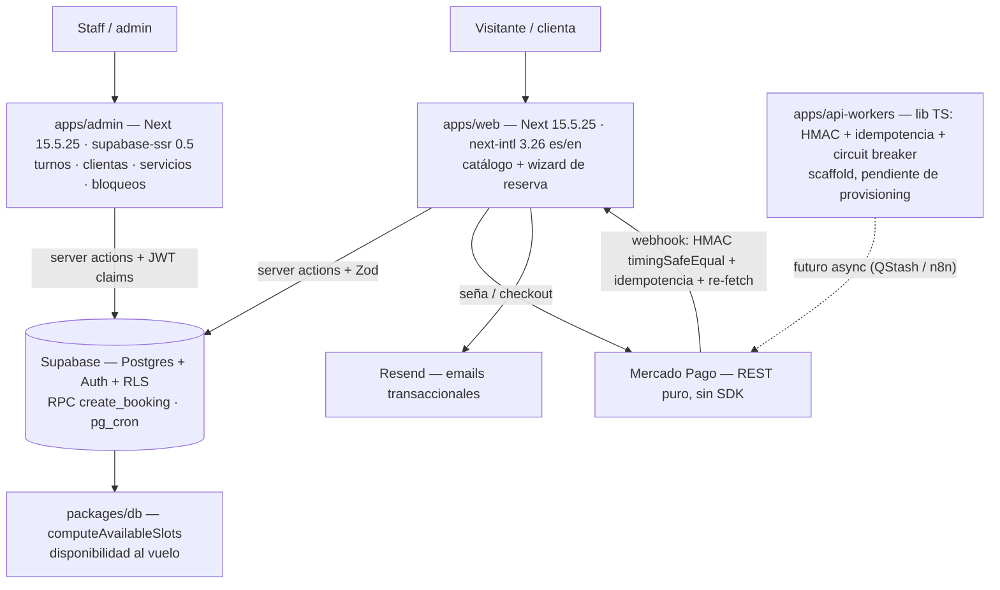

# KHAL — Architecture (cómo se arma)

> **Búsqueda:** keywords: `khal, arquitectura, monorepo, turbo, next-15, supabase, rls, rpc, turnos, mercadopago, webhook, disponibilidad` · clasificación: `arquitectura` · estado: `canónico` · actualizado: 2026-10-17
> Parte de: [[README]] · Relacionados: [[03-funciones]] · [[supabase-migration]] · [[ADR-0001-auth-provisoria]] · [[API]]
> Absorbe y reemplaza a `docs/02-arquitectura-stack.md` (allí quedó un redirect permanente). Versiones re-verificadas contra los `package.json` reales el 2026-10-17: el 02 viejo narraba una versión de Next desactualizada — el real es **15.5.25**.

## Overview

Monorepo **pnpm + Turbo** para un negocio de turnos: catálogo público bilingüe (es/en) + wizard de reserva (`apps/web`), agenda de staff (`apps/admin`) y una lib de webhooks async (`apps/api-workers`, scaffold). Backend único: **Supabase** (Postgres + Auth + RLS + RPC + Storage + pg_cron). La disponibilidad **nunca se pre-genera**: se computa al vuelo en `packages/db`. Toda escritura pasa por server actions validadas con Zod o por la RPC `create_booking`.



## Stack (verificado contra los `package.json` reales, 2026-10-17)

| Capa | Tecnología | Fuente |
|---|---|---|
| Framework web/admin | Next.js **15.5.25** (pinned, App Router) | `apps/web/package.json`, `apps/admin/package.json` |
| UI | React ^19.1.0 · Tailwind CSS ^4.1.0 (vía `@tailwindcss/postcss`, sin `tailwind.config`) | ídem |
| i18n | `apps/web`: next-intl ^3.26.5 · `apps/admin`: next-intl ^4.14.2 (divergencia mayor real entre apps) | ídem |
| Datos | Supabase: `@supabase/supabase-js` ^2.45.0 en web y admin; `@supabase/ssr` ^0.5.2 solo en admin | ídem |
| Validación | Zod ^3.24.2 (web/admin) · Zod ^3.24.0 (api-workers) | ídem |
| Email | resend ^6.28.1 | `apps/web/package.json` |
| Editor admin | Tiptap ^2.26.1 (react/pm/starter-kit/underline) | `apps/admin/package.json` |
| Monorepo | pnpm 12.3.4 workspaces + Turbo ^2.5.0 (`build`/`lint`/`typecheck`/`test`) | `package.json` raíz |
| Tests | Vitest ^3.1.1 · Playwright ^1.51.0 (+ `playwright.visual.config.ts` para visuales) | ídem |
| Tooling | TypeScript ^5.7.3 · ESLint ^9.24.0 · Prettier ^3.9.6 · Husky ^9.1.7 + lint-staged ^17.5.1 · Changesets ^3.0.2 | ídem |

## Mapa del monorepo

| Path | Qué es |
|---|---|
| `apps/web` | Catálogo público + flujo de reserva (es/en) |
| `apps/admin` | Agenda staff: turnos, clientas, servicios, bloqueos |
| `apps/api-workers` | Lib `type:module` (`exports: ./src/index.ts`): webhooks HMAC-SHA256 + idempotencia + circuit breaker + env validado — **scaffold, sin provisioning** |
| `packages/db` | Motor de disponibilidad: `computeAvailableSlots`, computo al vuelo |
| `packages/validations` | Schemas Zod: servicio, `bookingInput`, máquina de estados del turno (`canTransitionAppointment`) |
| `packages/utils` | Dinero en centavos enteros (`computeAmountDueCents`, ROUND_HALF_UP), fechas, links WhatsApp |
| `packages/types`, `packages/ui` | Tipos y UI compartidos |
| `supabase/migrations` | 0001→0010 (**down.sql presente desde 0006**): initial schema+RLS, auth roles, RPC `create_booking`, `processed_events` (event_key unique → NOT NULL full index), fix search_path, schedule gates, `global_settings` anon select, revoke anon grants, bucket `service_photos` |
| `openspec/` | Specs y cambios SDD (`virtual-agenda`, `khal-f3-cierre`, …) |

## Decisiones de arquitectura (ver `openspec/changes/virtual-agenda/design.md`)

- **Disponibilidad computada (SCH-01):** slots al vuelo desde `provider_schedules`/`business_hours` menos `calendar_exceptions` y turnos confirmados. Horario mock actual: lun–sáb 09:00–18:00, domingo cerrado (`apps/web/src/lib/mocks/schedule.ts`).
- **Dinero entero (MONEY-01):** `price_cents INT` + `currency_code CHAR(3)`; aritmética entera con ROUND_HALF_UP (`packages/utils/src/money.ts`). Seña: `full` / `fixed` / `percentage` (bp).
- **Fechas UTC (DB-01, TZ-01/02):** se guarda UTC, se muestra en `America/Argentina/Buenos_Aires`.
- **Estados estrictos (ECOM-03):** `pendiente → confirmado/cancelado/no_asistio`, sin saltos.
- **Env fail-closed:** `apps/web/src/config/env.ts` valida con Zod al boot y rechaza arrancar con variables faltantes. `NEXT_PUBLIC_*` = browser-safe; resto server-only; service-role/QStash = críticas (rotación 90 días).
- **Webhooks desconfiados:** firma HMAC (`timingSafeEqual`), dedup por idempotencia y **re-fetch del pago** (nunca confiar en el body). Mercado Pago por REST puro, sin SDK; el monto se calcula server-side (`apps/web/src/lib/actions/payment.ts`).

## Cómo correrlo

```bash
pnpm install
pnpm exec turbo run typecheck
pnpm exec vitest run
pnpm exec eslint . --max-warnings 0
pnpm exec prettier --check .
```

Copiar `.env.example` a `.env.local`. Conexión Supabase: `docs/supabase-migration.md`. Automatizaciones: `docs/automations.md`.

---
*Stack y estructura verificados contra los archivos reales el 2026-10-17 (ticket [FLEET-DOCS] t_859f9245). Re-verificar versiones: `node -p "require('./apps/web/package.json').dependencies.next"` · `ls supabase/migrations`.*
