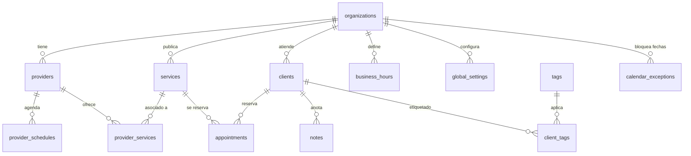

# DATABASE — Khal

> **Búsqueda:** keywords: `khal, database, supabase, schema, rls, migraciones, create_booking, model de datos` · clasificación: `doc-sistema` · estado: `canónico` · actualizado: 2026-10-17
> Parte de: [[README]] · Relacionados: [[ARCHITECTURE]], [[docs/API]], [[docs/DESIGN]]

## Identidad de la base

| Campo | Valor |
|-------|-------|
| Proveedor | Supabase (Postgres 17.6) |
| Ref | `epykihchzlbbptrvvawg` |
| Región | us-west-2 |
| Estado | ACTIVE_HEALTHY (verificado 2026-10-07) |
| Acceso ops | PAT `SUPABASE_PAT_2` (Management API) — el MCP de Supabase del workspace NO ve esta DB |
| Verificación canónica | `E:/Hermes/docs/audits/rls-verify-khal-2026-10-07.md` (ORN-168 cerrado-verificado) |

## Resumen del modelo

Khal es multi-tenant (una `organization` = un estudio de pestañas), con `providers` como primera clase ciudadana (multi-profesional ready). El catálogo (`services`) es público vía RLS con soft delete; los turnos (`appointments`) y clientas (`clients`) son org-scoped. La idempotencia de reservas vive en `processed_events` (event_key único). El pago de seña NUNCA pasa por la DB: se coordina por WhatsApp.

## Diagrama de relaciones



## Tablas (17 + 1 view)

| Tabla | Propósito | RLS | Superficie anon |
|-------|-----------|-----|-----------------|
| `organizations` | Tenant root — timezone, currency | 1 policy (select own or admin) | ninguna |
| `providers` | Profesionales del estudio | 2 (anon_select is_active; member_all) | SELECT público |
| `services` | Catálogo — precio, duración, foto, Tiptap body | 2 (anon_select is_visible+deleted_at null; member_all) | SELECT público |
| `business_hours` | Horarios de atención por día | 2 (anon_select; member_all) | SELECT público |
| `provider_schedules` | Disponibilidad específica por profesional | 2 (anon_select is_active; member_all) | SELECT público |
| `appointments` | Turnos — el corazón del negocio | 2 (admin/manager CRUD; member_select) | ninguna |
| `clients` | Clientas — nombre, WhatsApp, historial | 2 (admin/manager; member_select) | ninguna |
| `notes` | Notas internas sobre clientas | member_all (org-scoped) | ninguna |
| `tags` | Etiquetas de clientas | member_all (org-scoped) | ninguna |
| `client_tags` | Join clientas ↔ tags | member_all (org-scoped) | ninguna |
| `provider_services` | Join profesionales ↔ servicios | member_all (org-scoped) | ninguna |
| `global_settings` | Config global (incl. deposit_mode) | member_all + anon SELECT payment fields (0008) | SELECT parcial (payment) |
| `calendar_exceptions` | Bloqueos: holiday/vacation/event/block | member_all (org-scoped) | ninguna |
| `audit_logs` | Auditoría de acciones | insert-only + admin select | INSERT-only |
| `security_logs` | Eventos de seguridad | insert-only + admin select | INSERT-only |
| `processed_events` | Idempotencia (event_key único, 0004/0005) | insert-only + admin select | INSERT-only |
| `failed_webhooks_log` | Webhooks fallidos para replay | insert-only + admin select | INSERT-only |
| `my_auth_context` (view) | Contexto de auth (security_invoker) | grants authenticated+service_role | ninguna (401 para anon) |

**RLS: 17/17 tablas habilitadas, 24 policies activas.** Patrón por tabla: `anon_select` (solo catálogo público) + `member_all` (todo lo demás, scoped por `org_id()`), con `admin`/`manager` para CRUD de datos sensibles.

## Enums (ECOM-03: estado con enums, no booleans)

| Enum | Valores | Uso |
|------|---------|-----|
| `appointment_status` | pendiente, confirmado, cancelado, no_asistio | appointments.status |
| `deposit_mode` | full, fixed, percentage | global_settings (seña 30% = percentage) |
| `exception_type` | holiday, vacation, event, block | calendar_exceptions |

## RPC: `create_booking` (0003, hardened 0006/0007)

Reserva de turnos con validación server-side. Verificado en vivo contra la DB (audit 2026-10-07):

| Test | Resultado |
|------|-----------|
| Happy path (slot disponible) | `ok=true` + booking_id |
| Idempotencia (replay con mismo event_key) | `ok=true` + **mismo** booking_id |
| Overlap total (mismo slot, phone distinto) | `ok=false, code=conflict` |
| Overlap parcial (dentro de ventana 60+15min) | `ok=false, code=conflict` |
| Servicio invisible (is_visible=false) | `ok=false` |
| Slot fuera de business_hours | `ok=true` — **gap P2 conocido**, schedule_gates lo mitiga (0007) |

`search_path=public, extensions` fijado por security definer (fix P0 del 2026-09-28).

## Storage

| Bucket | Uso | Policies |
|--------|-----|----------|
| `service-photos` (0010) | Fotos de servicios (admin upload) | staff-only write, public read, cap 4MB en app |

## Migraciones (0001→0010, todas aplicadas)

| # | Nombre | Qué hace |
|---|--------|----------|
| 0001 | initial_schema | 17 tablas, enums, triggers, índices |
| 0002 | auth_roles | Roles auth (member, admin, manager) |
| 0003 | create_booking_rpc | RPC de reserva con idempotencia |
| 0004 | processed_events_event_key | event_key unique |
| 0005 | event_key_not_null_full_index | índice full + NOT NULL |
| 0006 | fix_create_booking_search_path | Hardening P0: search_path fijo |
| 0007 | create_booking_schedule_gates | Valida schedules contra slots |
| 0008 | global_settings_payment_anon_select | anon lee deposit_mode/amount |
| 0009 | revoke_anon_grants | Revoca grants anon innecesarios |
| 0010 | service_photos_bucket | Storage bucket para fotos |

## Patrones del constitution (aplicados)

- **DB-01**: `updated_at` trigger en toda tabla
- **DB-02/04**: RLS en toda tabla; soft delete vía `deleted_at` (nunca DELETE físico)
- **MONEY-01**: `price_cents INT` — nunca float para dinero
- **ECOM-03**: enums para estados de lifecycle, no booleans
- **IDX-01**: índices en FKs y columnas de query frecuente
- **SCH-01/02/03**: schema namespaced en `public`, extensions en `extensions`

## Cómo conectarse (dev)

```bash
# Variables del .env del proyecto (nunca commitear):
SUPABASE_URL=https://epykihchzlbbptrvvawg.supabase.co
SUPABASE_ANON_KEY=...   # solo lecturas públicas (RLS aplica)
SUPABASE_SERVICE_ROLE=... # solo server-side workers (bypass RLS)
```

Para queries directas: Management API con PAT (ver audit para el patrón curl). El MCP de Supabase del workspace Hermes NO tiene esta DB linkeada.

## Fuente de verdad

- Schema vivo: `api.supabase.com/v1/projects/epykihchzlbbptrvvawg/database/query`
- Migraciones: `supabase/migrations/0001→0010` en el repo
- Verificación RLS end-to-end: `E:/Hermes/docs/audits/rls-verify-khal-2026-10-07.md`
- Tipos TS generados: regenerar tras cada migración con `supabase gen types`
