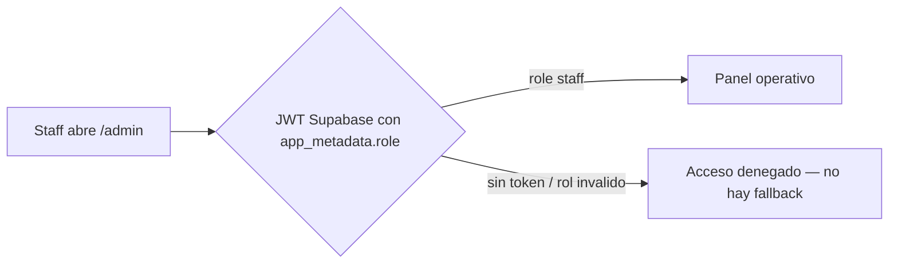

# Flujo del admin — operación del estudio (apps/admin)

> **Fecha:** 2026-10-15 · **Autor:** 24-gentle (hermes) · **Motivo:** documentar el panel de administración: auth, entidades operables y estado real de cada pantalla
> **Búsqueda:** keywords: `admin, panel, staff, jwt, turnos, clientes, excepciones` · clasificación: `product` · estado: `vigente`
> **Resumen:** El panel interno (apps/admin): modelo de auth fail-closed por JWT, las cuatro entidades operables (turnos, servicios, clientas, excepciones) y el gap actual de acceso (sin form de login hasta provisionar staff). Para ventas, onboarding y QA.
> **Parte de:** [[README]] · Relacionados: [[adr/ADR-0001-auth-provisoria]], [[06-estado-gates]], [[flujo-cliente]], [[SECURITY]]

## Acceso (fail-closed)

- **ADR-0001 (aplicada, ORN-79):** el mock de cookie fue eliminado; la única vía es el JWT de Supabase con claim `app_metadata.role`. Sin token válido el acceso se niega — **fail-closed**, no hay login alternativo.
- **Gap actual:** NO existe form de login y no hay usuarios staff provisionados en la DB → hoy el panel no puede operarse. Es el ítem pendiente #1 del [[06-estado-gates]] para "producción real". Al provisionar: `app_metadata.role = 'staff'` en el usuario de Supabase Auth.

## Entidades operables (componentes verificados en `apps/admin/src/components/admin/`)

| Pantalla | Componente | Qué hace |
|---|---|---|
| Turnos | `appointment-list.tsx` | Lista de turnos con transiciones de estado (pendiente → confirmado / no-show) |
| Servicios | `service-list.tsx` | Toggle de visibilidad por servicio + acciones bulk; el servicio oculto deja de aparecer en la web pública al instante (RLS filtra `is_visible`) |
| Clientas | `client-list.tsx` | Lista con LTV por clienta y toggle de blacklist (la clienta bloqueada recibe `error.blacklisted` al intentar reservar) |
| Excepciones | `exceptions-list.tsx` | Alta de horarios bloqueados (feriados, vacaciones) que restan slots en la web pública |

## Convenciones de calidad que el admin ya cumple

- Ring de foco visible en TODOS los botones (contrato ORN-59 H2, testeado en `apps/web/test/a11y-p2-contract.test.ts`).
- `aria-current` en la navegación activa (hallazgo P2 corregido).
- Estados semánticos con color + texto (badge de no-show, servicio oculto), nunca color solo.
- UI todavía en tema claro original — el dark brand se aplicó solo a la web pública (pendiente P2).

## Evidencia

- `apps/admin/src/components/admin/` — los 4 componentes con sus contratos a11y.
- `docs/adr/ADR-0001-auth-provisoria.md` — decisión de auth aplicada (status: superseded → implementada).
- Tests de contrato: `apps/web/test/a11y-p2-contract.test.ts` (ring) y `apps/web/test/a11y-fixes.test.tsx`.
