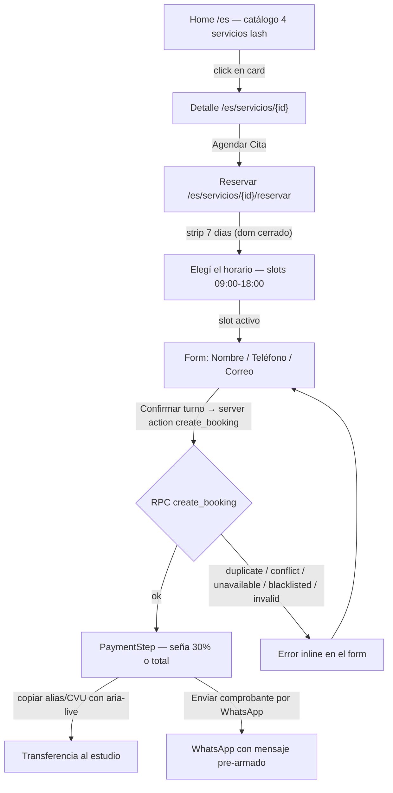

# Flujo de la clienta — reserva de turnos (web pública)

> **Fecha:** 2026-10-15 · **Autor:** 24-gentle (hermes) · **Motivo:** documentar el journey completo de reserva tras el re-baseline del catálogo 100% pestañas
> **Búsqueda:** keywords: `flujo, reserva, clienta, booking, happy-path, e2e` · clasificación: `product` · estado: `vigente`
> **Resumen:** Journey punta a punta de la clienta sobre la web pública (`/es`): catálogo, detalle de servicio, selección de día/horario, datos, confirmación vía RPC `create_booking` y pantalla de seña con WhatsApp. Para ventas, onboarding y QA.
> **Parte de:** [[README]] · Relacionados: [[03-funciones]], [[06-estado-gates]], [[API-GUIDE]], [[flujo-admin]]

## Journey completo

## Detalle por paso

| Paso | Ruta / componente | Comportamiento verificado |
|---|---|---|
| 1. Catálogo | `[locale]/page.tsx` → `CatalogGrid` | Lee `services` vía PostgREST con RLS anon (`is_visible and deleted_at is null`), orden `sort_order`. Fail-soft: sin env de Supabase muestra estado vacío, nunca crashea. 4 servicios: Lifting, Clásicas 1:1, Híbridas, Volumen Ruso (seña 30% en todos). |
| 2. Detalle | `[locale]/servicios/[id]/page.tsx` | Título, descripción, duración y seña; barra fija inferior con precio + CTA "Agendar Cita". `notFound()` si el servicio no existe o no es visible. |
| 3. Días | `SlotPicker` (día) | 7 días desde hoy. Domingo cerrado; horario base Lun-Sáb 09:00-18:00 (espejo de `business_hours` en la DB). `aria-pressed` en cada botón. |
| 4. Horarios | `SlotPicker` (slot) | Slots calculados server-side con `computeAvailableSlots` (día + buffer del servicio). Sin slots → "Sin turnos" inline. |
| 5. Datos | `BookingForm` + `Field` | Nombre / Teléfono / Correo, labels explícitos (a11y), todos required. Sin Turnstile todavía (pendiente P2). |
| 6. Confirmación | server action `createBooking` | Llama RPC `create_booking` contra la DB viva. Errores mapeados a mensajes i18n: `error.duplicate`, `error.conflict`, `error.unavailable`, `error.blacklisted`, `error.invalid`. |
| 7. Seña | `PaymentStep` | Monto = 30% del servicio (o total si no define seña). Alias + CVU con botón copiar (`aria-live` "Copiado"). CTA WhatsApp con mensaje pre-armado (servicio, fecha, horario). |

## Qué NO hace el flujo (hoy)

- No hay rutas `/pago/exito|error|pendiente` (asociadas a MP, que está fuera por decisión de la dueña).
- No hay registro/login de clienta: la reserva es de invitada.
- No envía recordatorios aún (el código de Resend+QStash existe pero no está verificado en vivo).

## Evidencia

- E2E `apps/web/e2e/booking-happy-path.spec.ts` — el journey completo contra el stub (verde en CI y local).
- RPC verificado en vivo: `docs/audits/rls-verify-khal-2026-10-07.md` (idempotencia, overlap, servicio invisible).
- Contrato del stub: `apps/web/e2e/server.mjs` espeja `supabase/seed.sql`.
