# Khal — Master Screen Map

> Mapa de todas las pantallas de khal (web clienta + admin) con paths de navegación.

```mermaid
graph TD
    subgraph Web["📱 Web Clienta (apps/web)"]
        Home["Home (/)<br/>Hero + Catálogo grid"]
        ServicioDetalle["Detalle Servicio<br/>(/servicios/[id])"]
        ReservarFecha["Reservar: Fecha<br/>(/servicios/[id]/reservar#fecha)"]
        ReservarHorario["Reservar: Horario<br/>(/servicios/[id]/reservar#horario)"]
        ReservarDatos["Reservar: Datos<br/>(/servicios/[id]/reservar#datos)"]
        Confirmacion["Confirmación<br/>Código + Seña + WhatsApp"]
        Politicas["Políticas<br/>(/politicas)"]
    end

    subgraph Admin["🔐 Admin (apps/admin)"]
        Login["Login OTP<br/>(/login)"]
        CodigoOTP["Código OTP<br/>Ingreso 6 dígitos"]
        Dashboard["Dashboard<br/>(/admin)"]
        Servicios["Servicios<br/>(/admin/servicios)"]
        ServicioEditor["Editor Servicio<br/>Tiptap + Foto upload"]
        Bloqueos["Bloqueos<br/>(/admin/bloqueos)"]
        Clientes["Clientes<br/>(/admin/clientes)"]
    end

    Home -->|"tap servicio"| ServicioDetalle
    ServicioDetalle -->|"tap Reservar"| ReservarFecha
    ReservarFecha -->|"fecha seleccionada"| ReservarHorario
    ReservarHorario -->|"horario seleccionado"| ReservarDatos
    ReservarDatos -->|"Confirmar"| Confirmacion
    Confirmacion -->|"WhatsApp"| Home

    Login -->|"email enviado"| CodigoOTP
    CodigoOTP -->|"código válido"| Dashboard
    Dashboard --> Servicios
    Servicios --> ServicioEditor
    Dashboard --> Bloqueos
    Dashboard --> Clientes

    Home -.-> Politicas

    classDef webScreen fill:#d1fae5,stroke:#059669,stroke-width:2px
    classDef adminScreen fill:#dbeafe,stroke:#2563eb,stroke-width:2px
    classDef critical fill:#fef3c7,stroke:#d97706,stroke-width:3px

    class Home,ServicioDetalle,Politicas webScreen
    class ReservarFecha,ReservarHorario,ReservarDatos,Confirmacion critical
    class Login,CodigoOTP,Dashboard,Servicios,ServicioEditor,Bloqueos,Clientes adminScreen
```

**Leyenda:**
- 🟢 Verde: pantallas web públicas (implementadas: Home con datos reales)
- 🟡 Amarillo grueso: flujo de reserva — crítico del negocio (skeletons actuales, necesitan implementación)
- 🔵 Azul: admin (implementados: login OTP + servicios funcionan en khal-admin deploy)
